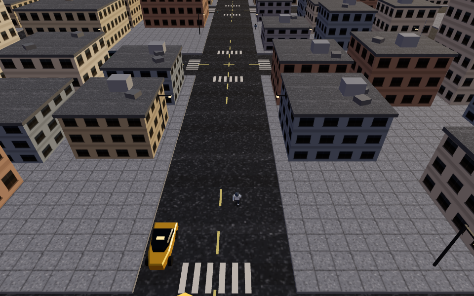
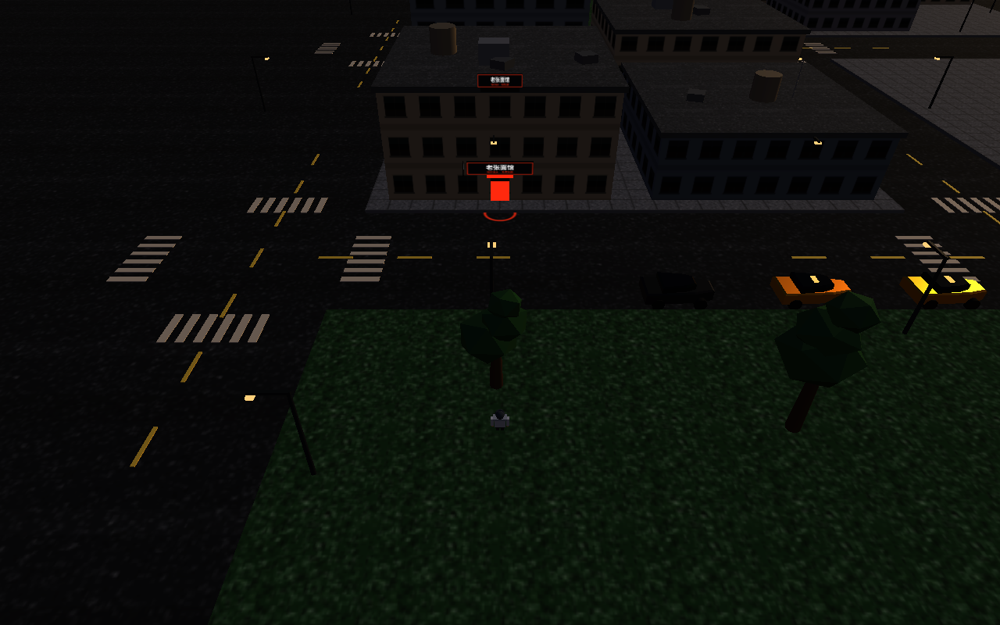
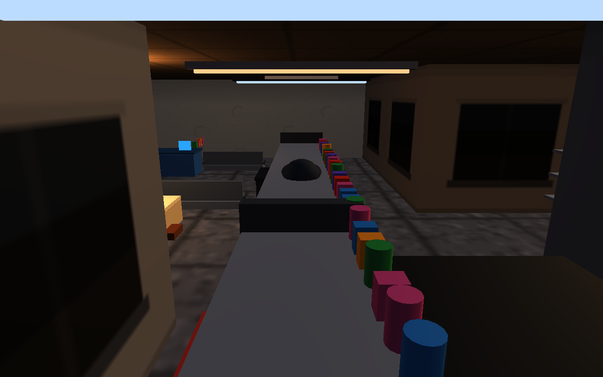
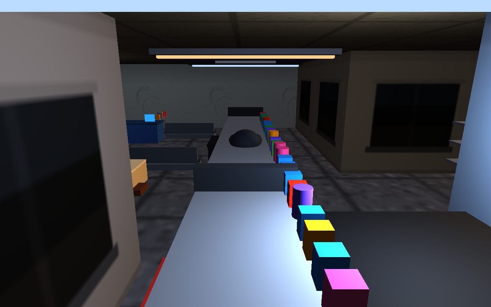

# 侠盗街区 (GTA Districts)

浏览器里的俯视侠盗小游戏:程序化生成的城市、开车穿楼群、下车步行跑跳打人、亮门脸的小店能推门进去,全程无读盘无加载。



街口就能认出谁家:`老张面馆` 的门头霓虹招牌 + 发光门洞 + 门口店色光圈,同框可见(下面是 GL 回读实拍,非合成层截图):



进店后的预制陈设房(GL 回读实拍,软渲染下偏暗,真实显卡明显更亮):吊灯光管、长工作台与成排彩色收纳、借街光的亮窗、四面抹灰墙与矿棉板顶,黑壳把城市整个挡在屋外;修车铺是冷白灯 + 蓝色卷帘门,五家店五种陈设:

 

## 玩

```bash
python3 serve.py          # 起本地服务器(默认 8017,禁缓存)
# 打开 http://127.0.0.1:8017/gta/
```

无构建步骤:three.js(r169)以 ESM 形式 vendored 在 `vendor/`,游戏本体是单文件 `gta/game.js`。

| 模式 | 按键 |
|---|---|
| 驾驶 | W/S/↑/↓ 油门刹车 · A/D/←/→ 转向 · Space 手刹漂移 · F 下车(可抢路人车) |
| 步行 | WASD 移动(W=屏幕纵深,A/D=横移)· **Shift 跑** · **Space 跳** · G 打人 · **E 进/出亮门脸小店** · F 就近上车 |
| 视角 | C 切三档机位 · 按住鼠标拖 = 转镜头(转到哪 W 就走向哪)· 滚轮缩放 · 松手 1.6 秒自动回正 |
| 通用 | R 回到最近路口重来 · 城市随机,URL 加 `?seed=xxx` 可固定重放同一座城 |

## 技术要点

- **程序化城市**:7×7 街区(楼群/公园/停车场三类地块),楼按 footprint×高度分 5 类贴图、全实例化渲染,几十个 draw call 撑起整城;天际线按规则掺 16–22 米高楼。
- **一个相机公式通吃开车/步行**:室外相机永远挂在全部屋顶之上,不需要遮挡裁剪,镜头机制(收镜头/防穿楼)按高度门槛整体休眠,开车步行视角字节级同款;进店后换独立的 5 米内机位小支(夹在屋墙里),两条公式互不掺和。
- **可进店(传送式)**:全城按规则标 5 家亮门脸小店(矮楼、footprint 够大、每街区最多 1 家、门前落脚点实测干净),门口按 E 切进预制陈设房、再按 E 回到门前。室内碰撞盒只在屋内生效、出门整段摘除;店内用一圈背面黑壳把城市挡在屋外——室外那套 24 米相机原则原封不动,进店零风险。
- **沿街好找店**:每家店加载后 5 秒预生成三层标志 —— 门头大招牌(正对街)、竖挑刀牌(沿街两个方向都能瞄见)、屋顶灯箱(字面朝街两面贴,远处天际线也能对上),加门口一圈店色光圈(脚下最后确认);招牌不进碰撞盒,不影响推人推车。
- **店里不穿模**:屋里陈设全部带碰撞盒(柜台/冷柜/轮胎堆/花盆不再是幽灵,人撞得上);店内机位若会埋进"上半身高过相机"的家具,沿"人→相机"连线自动收位贴人;吊灯吊高在起跳峰值头高之上,屋里跳也不穿灯。
- **定种子随机(mulberry32)**:`?seed=` 复现同一座城;验证套件每轮自动打印种子,红了一定能重放。
- **活的城市**:车流有让行/转弯/路口潮汐(30 辆在路上跑,用户:车再多点动起来),行人散步/过马路/怕车/会打架,被碾会被撞会自己爬起来。

## 验证(这仓库的重点)

软渲染 4fps 的游戏里,"看起来坏了"九成是观测采样背运气。所以全套断言锚在 `game.js` 暴露的 `window.__gta` 调试面上,用无头 Chrome 实跑:

```bash
python3 serve.py &                                  # 套件需要服务器在跑
node verify/gta.mjs                                 # 62 项断言,一次几分钟;红了把打印的种子喂回去 `node gta.mjs <seed>` 原样重放
node verify/probes/probe23.mjs                      # probe1–23 及一次性脚本共 38 个定点复现器
```

- 套件按实测时间流速自动放大所有等待窗口(机器越慢,游戏时间越慢,断言不跟着误伤);
- 新断言一律"轮询观测 + 换目标重试",不写单点定时采样;
- 验收规矩:**连续两轮"全部通过"才算改完**(双绿)。

## 目录

```
gta/          游戏本体(game.js + index.html)
verify/       无头验证套件(gta.mjs + probes/ + shots/,依赖 puppeteer-core + 本机 Chrome)
docs/         文档素材
archive/      一期原型(已退役,勿当主干)
vendor/       three.module.js(唯一外部依赖)
```

## 已知边界

- 无警察/通缉/任务系统;车损不做(撞了不瘪,人会飞)。
- 软渲染下约 4–10 fps,有独显的浏览器会好一个数量级。
- dt 夹在 0.05s:机器过慢时游戏进入慢动作而非丢帧(仿真按自己的钟走)。
